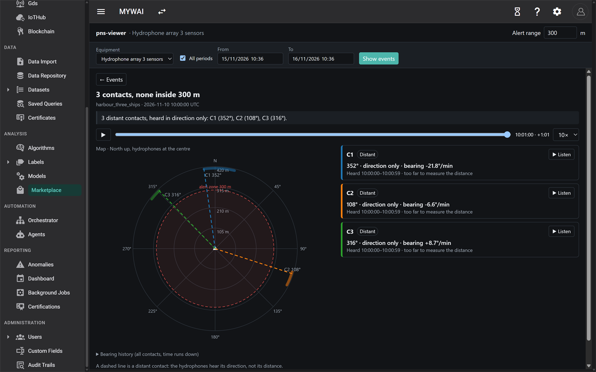

A toolkit is a **static web application**: HTML, JavaScript, CSS and media files. Use any
framework or none. The Platform needs no SDK and no code from you on its side: it reads your
manifest, serves or opens your files and talks to your page with the
[mywai.toolkit.v1 protocol](/3.2/marketplace-tools/toolkits/protocol).

## Checklist

1. Serve the application from a base URL, with `index.html` at its root.
2. Publish `mywai-toolkit.json` at the same root.
3. Use **relative** paths for every asset (`app.js`, `assets/logo.svg`), never `/app.js`.
4. Route between your pages with the **URL hash** (`#/`, `#/event`), not with the path.
5. Implement the protocol: send `ready`, handle `init` and `events`, check origins.
6. Work inside an iframe of any size, in the dark and the light theme.

## Deploying the toolkit

Deploy the toolkit next to the algo service it belongs to, for example as an extra service
of the same compose file that serves the folder with a plain web server:

```yaml
services:
  my-algo-toolkit:
    image: docker.io/library/nginx:1.27-alpine
    ports:
      - "8521:80"
    volumes:
      - ./toolkit:/usr/share/nginx/html:ro
    restart: unless-stopped
```

The Platform reaches the toolkit in one of two ways, chosen when the toolkit is registered:

| Mode | Who downloads the files | URL to register |
| --- | --- | --- |
| **Served through the Platform API** (default, recommended) | the Platform Web API, server side; the browser receives them from the API | an address the **Web API server** can reach, e.g. `http://my-algo-toolkit:80/` on the same container network |
| **Opened directly** | the user's browser | an address the **browser** can reach, in HTTPS when the Platform is in HTTPS |

### Rules of the Platform proxy

When the files are served through the Platform API, the iframe opens:

```text
https://<platform-api>/toolkits/<toolkit id>/t/<launch ticket>/index.html#<route>
```

The launch ticket is bound to the user and to the toolkit and lasts 8 hours. It is part of
the path, so relative asset URLs inherit it automatically. This is why absolute paths
(`/app.js`) do not work: they would leave the ticket out.

The proxy only serves static files:

- only `GET` requests, for paths made of plain segments: letters, digits and `. _ ~ @ + -`
  (no spaces, no `..`, no encoded separators); query strings are ignored;
- only these content types: `text/html`, `text/css`, `text/javascript`,
  `application/javascript`, `application/json`, `application/manifest+json`,
  `application/wasm`, `text/plain`, `image/*`, `font/*`, `audio/*`, `video/*`.
  Anything else, or a response without a content type, is refused (HTTP 415);
- at most **20 MiB** per file;
- responses carry a restrictive `Content-Security-Policy`, `X-Content-Type-Options: nosniff`
  and a private cache of 5 minutes. Only the Platform Web origin may frame them; scripts,
  assets and network requests stay on the Web API origin. Bundle dependencies locally:
  external CDNs and inline scripts are blocked. Inline styles are allowed, as are
  `blob:`/`data:` images and media for files received from the host. Forms and embedded
  objects are blocked.

<Warning>
The proxy is for code and static assets. Do not use it to call a backend of your own: the
data a toolkit shows comes from the Platform through the protocol.
</Warning>

When the files are opened directly, the iframe opens `<web URL>/index.html#<route>` and the
same rules for paths and routing apply.

### The iframe sandbox

The page runs in an iframe with `sandbox="allow-scripts allow-same-origin allow-downloads"`
and `referrerpolicy="no-referrer"`. Therefore:

- `alert()`, `confirm()` and `prompt()` do nothing, and pop-up windows do not open:
  show messages and dialogs inside the page;
- the page cannot navigate the Platform window or submit forms;
- file downloads started by the page (e.g. an export) are allowed.

When served through the Platform API, every proxied toolkit runs on the origin of the Web
API. Do not rely on cookies, and prefix `localStorage` or IndexedDB keys with the name of
your toolkit.

## The manifest: `mywai-toolkit.json`

Publish the manifest at the root of the toolkit, next to `index.html`:

```json
{
  "protocol": "mywai.toolkit.v1",
  "name": "Tactical display",
  "routes": [
    { "path": "/", "title": "Overview", "integrations": ["standalone", "period-events"] },
    { "path": "/event", "title": "Selected events", "integrations": ["selected-events"] }
  ]
}
```

| Field | Rules |
| --- | --- |
| `protocol` | exactly `mywai.toolkit.v1` |
| `name` | optional; proposed as the tool name when the tool is registered |
| `routes` | 1 to 32 routes |
| `routes[].path` | starts with `/`, made of letters, digits and `. _ ~ / -`; no `//`, `.` or `..` segments; unique |
| `routes[].title` | 1 to 60 characters |
| `routes[].integrations` | at least one integration of the [census](/3.2/marketplace-tools/toolkits#integrations) |

The file is read by the Platform Web API when the administrator registers the toolkit, and
again each time they press **Read mywai-toolkit.json**. It must answer HTTP 200 within 30
seconds and weigh at most 64 KiB. If a rule is broken the Platform shows the reason, for
example `Route '/event': unknown integration 'selected-event2'`.

A route is a page of your application. Where it opens:

- in the **Marketplace**, the Platform opens the first route that declares `standalone`;
- in **Historical**, the administrator picks the route of each view among the ones that
  declare the integration of the view.

The Platform opens `index.html#<path>` and also sends the route in the `init` message, so
read the hash at startup or wait for `init`.

## What the page receives in each integration

| Integration | Your page should | Data |
| --- | --- | --- |
| `standalone` | let the user choose an equipment and a period, then send `context.request` | `init.equipments`, `init.api` (endpoint, user token and expiry); `events` after each request |
| `period-events` | list the events and page through them with `page.request` | `events` with `paged: true`, page by page |
| `selected-events` | show the events chosen in the Platform; open the one in `focus` | `events` with `selected: true`, `paged: false`, and `focus`. With no selection, an empty `items` list |

In every integration the events come with the rows and files of the signals selected in the
Platform. See the [protocol](/3.2/marketplace-tools/toolkits/protocol) for the exact
payloads. When a measured location is configured and available in Historical, the context
also includes the equipment's last position and track for the period. Handle
[`cursor`](/3.2/marketplace-tools/toolkits/protocol#location-and-cursor) to follow the chart
cursor and to highlight a recorded position on the Historical map during toolkit replay.

The other hosted integrations are `live`, `file-viewer`, `processing-result`,
`dashboard-widget`, `equipment-tab`, `dataset-version` and the three `image-*` viewers.
Implement their [specific messages](/3.2/marketplace-tools/toolkits/protocol#other-hosted-integrations)
when declaring those integrations. Do not interpret them as an `events` message.

## User interface guidelines

- **Size**: the iframe fills its hosted viewer area or the whole
  Marketplace area. It changes with the window and the side menu: use a fluid layout.
  For ThreeD files, **Both** shares the width with the native viewer and stacks the panels
  on narrow screens. In Historical, **Both** keeps the chart below the toolkit. The native
  3D view opens first unless the user has a remembered choice or opens a link to a view.
- **Theme**: `init.theme` is `dark` or `light`. Apply it at startup.
- **Locale**: `init.locale` is the language of the user's browser (e.g. `it-IT`); format
  dates and numbers with it. Event times are UTC milliseconds.
- **Embedded vs standalone**: in Historical the Platform already shows the equipment, the
  period and the event list in its own panels. Hide your own filters there and show them only
  in `standalone`, as in the example below.
- **Label**: `init.label` is the name chosen by the administrator for the view. Show it as
  the title of the page instead of a fixed name.
- **Errors**: when your page cannot show the data, send an `error` message. In Historical,
  the Platform returns to the native chart and explains why; the toolkit view remains
  available in the switch so the user can retry. Standalone shows the reason.
- **Session**: `init.api` and `init.user` are sent in standalone and in any view with
  **Send the user's access token** enabled. Token sharing for views is off by default and
  should be enabled only for trusted toolkits, which can call APIs as the viewing user.
  When `init.api` is present, replace its token and expiry when `token.refreshed` arrives.
- **Live events**: handle a fresh first page of `events` after Platform changes. With
  **Live** enabled, page 1 also polls every 60 seconds for Edge-acquired events, or every
  30 seconds while disconnected. The separate `live` integration sends incremental rows.
- **Navigation**: send `navigate` with a route declared in your manifest to mirror it in the
  Platform URL.



## Testing the toolkit

1. Serve the folder locally (for example with the compose service above) and open
   `http://localhost:<port>/mywai-toolkit.json` in a browser to check the manifest.
2. Register it on a test Platform with **Web URL** `http://localhost:<port>/` (see
   [Registering a toolkit](/3.2/marketplace-tools/toolkits/registration-and-views)) and
   check that **Read mywai-toolkit.json** lists your routes.
3. Open it from the Marketplace (standalone), then configure a view and open it in
   Historical.
4. Use the browser developer tools on the iframe to inspect the messages: every message of
   the protocol has `"protocol": "mywai.toolkit.v1"`.

When testing `processing-result`, use a real processing session with file outputs. The
Platform reads each file from the successful signed child job that produced it; the session
ID groups the results and is not itself a file-producing execution. Verify an actual file
request, not only the inline rows or the successful analysis status.
