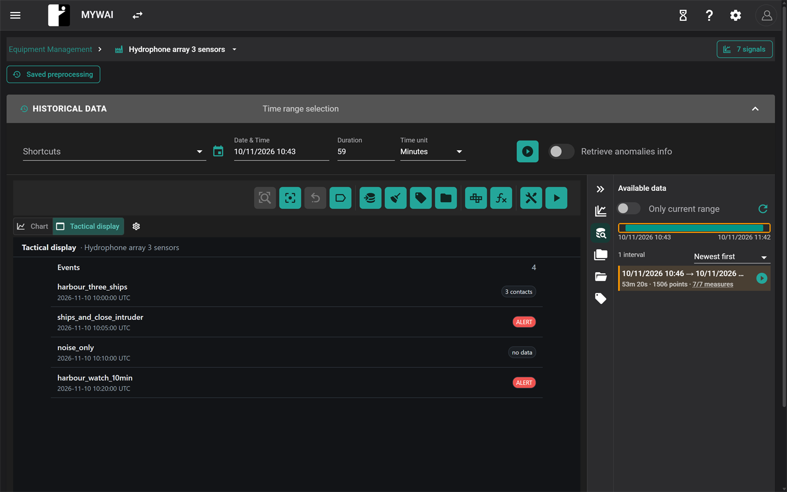
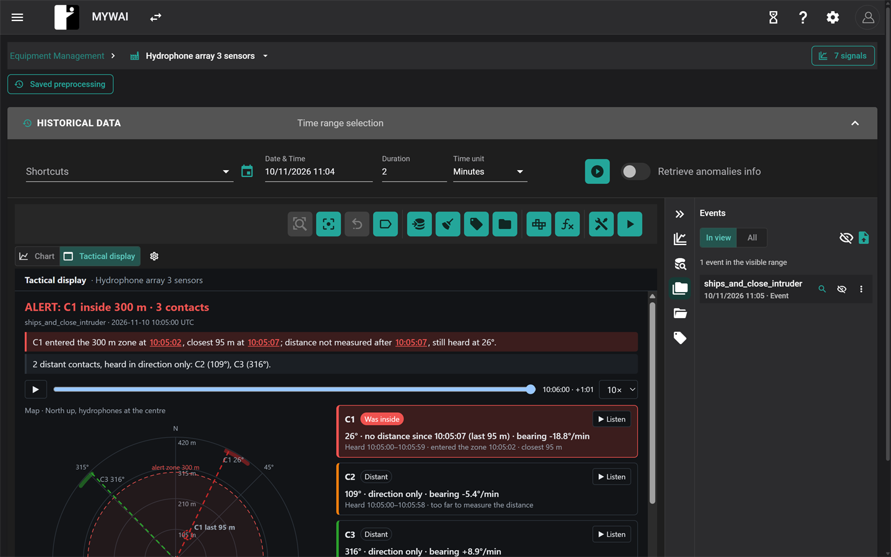
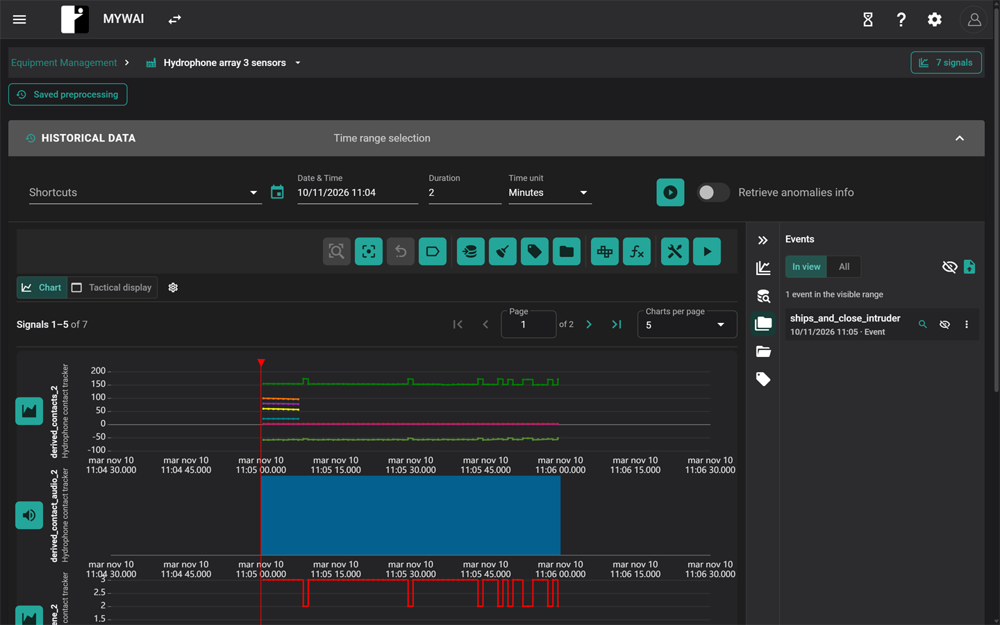
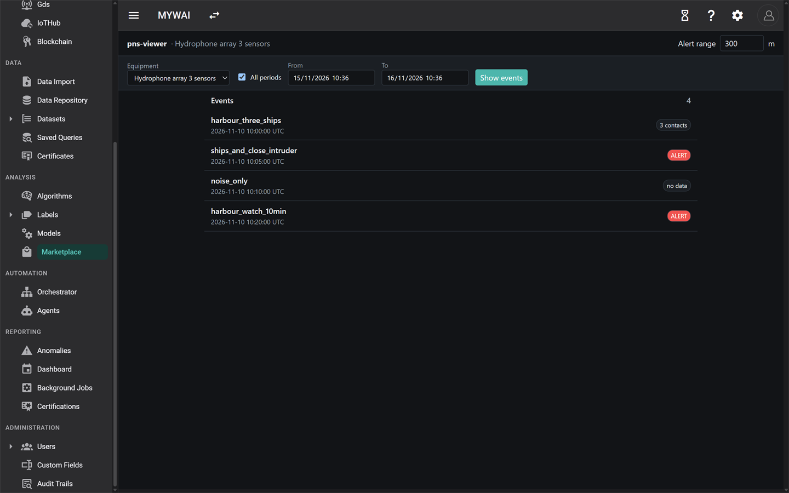
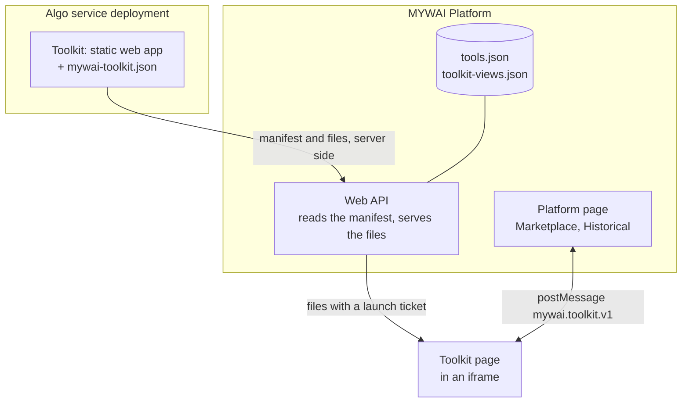

A **toolkit** is a web application that the MYWAI Platform hosts inside its own pages. It
is a special kind of Marketplace tool: besides opening as an application of its own in the
Marketplace, it can appear **next to the chart of Historical** and show the events and
signals the user is looking at.

The Platform and the toolkit talk through one versioned `postMessage` protocol,
**`mywai.toolkit.v1`**. The toolkit never needs to know where the Platform is installed,
which equipment exists or how the data is stored: the Platform pushes the data to it.

<Info>
Toolkits are available from Platform 3.2. Marketplace tools built with the previous
bootstrap message keep working: see [Tool development guidelines](/3.2/marketplace-tools/tool-development-guidelines).
</Info>

For complete click paths through all twelve hosted places, see [Using toolkit views](/3.2/marketplace-tools/toolkits/using-toolkit-views).

## What the user sees

In **Historical**, when the selected signals match a configured view, a switch appears
above the chart: **Chart** and one button per view, labelled as the administrator decided.
In this example the view "Tactical display" opens by default instead of the chart and lists
the events of the period.

When the user opens an event from the **Events** panel (go to or highlight), Historical
narrows the period to that event and the toolkit shows it directly.

The **Chart** button always brings back the native chart. With ThreeD signals selected,
Historical starts with the chart and native 3D viewer even if a view has **Open by default**.
Choose a view and then **Both** to keep the chart visible below the toolkit. For a ThreeD
file, **Both** places the native viewer and toolkit side by side, stacked on narrow screens.

The browser remembers the choice for each user and 3D place; that choice takes precedence
on the next visit. A toolkit failure restores the native content for the current page
without changing the remembered choice. See [Configuring views](/3.2/marketplace-tools/toolkits/registration-and-views#3-how-users-see-the-view).

In the **Marketplace** the same toolkit opens as an application of its own (standalone).
There the toolkit lets the user choose an equipment and a period, and the Platform sends it
the matching events.

## How the pieces fit together

1. **The toolkit is deployed by its algo service** (or any web server), next to it: usually
   an extra container that serves static files.
2. **The toolkit describes itself** in `mywai-toolkit.json`, a static file at its root: its
   pages (routes), their titles and the **integrations** each page supports.
3. **An administrator registers it** in the Marketplace with its Web URL only. The Platform
   reads the manifest server side and stores the routes.
4. **An administrator configures views**: which route opens in Historical, with which label,
   for which equipment types and signals.
5. **The Platform hosts the page** in an iframe and exchanges `mywai.toolkit.v1` messages
   with it: context, events, signal rows, files on request.

## Integrations

An **integration** says at the same time *where* a toolkit page appears in the Platform and
*what* it receives. The list is closed and part of the standard: a toolkit declares the
integrations of each route in its manifest.

| Integration | Where it appears | What the page receives | Hosted in 3.2 |
| --- | --- | --- | --- |
| `standalone` | Marketplace, as an application of its own | user token, accessible equipment; it asks for an equipment and a period and receives events and signal rows | Yes |
| `period-events` | Historical, as an alternative to the chart | equipment, selected signals, period; the events of the period, paged, with their signal rows | Yes |
| `selected-events` | Historical: the events selected in the Events panel | the selected events (one or more) with the rows and files of their signals | Yes |
| `live` | Historical in real time | equipment and signals; the last time window, then added rows on refresh | Yes |
| `file-viewer` | In place of the native viewer of a data type | one file, its signal and its event | Yes |
| `image-classification` | In place of the image classification viewer | images with predicted labels and scores | Yes |
| `image-anomaly-detection` | In place of the image anomaly detection viewer | images with anomaly maps and scores | Yes |
| `image-object-detection` | In place of the image object detection viewer | images with regions, labels and scores | Yes |
| `processing-result` | Preview of algorithm or preprocessing results | the job outputs | Yes |
| `dashboard-widget` | A Dashboard widget | latest values of the configured signals | Yes |
| `equipment-tab` | A tab of the equipment page | equipment, signals, latest events | Yes |
| `dataset-version` | The page of a dataset version | the items of the version, paged | Yes |

A toolkit may already declare an integration that is not hosted yet: the manifest is
accepted, and the route becomes usable as soon as a Platform release hosts it. An
integration outside this list is refused. The Platform returns the current list with
`GET /toolkits/integrations`.

## Toolkits and classic Marketplace tools

| | Classic tool | Toolkit |
| --- | --- | --- |
| Where | Marketplace only | Marketplace, Historical, and the places of declared integrations |
| Data | the tool calls the Platform API with the user token | the Platform pushes events, signal rows and files; `standalone` receives a token, as does any view with **Send the user's access token** enabled |
| Registration | metadata typed by hand | Web URL; the routes are read from the manifest |
| Hosting | the browser opens the tool URL | the Platform can serve the files through its API, so the browser never reaches the algo network |
| Messages | `mywai-tool-init` bootstrap | `mywai.toolkit.v1` protocol |

## Read next

- [Building a toolkit](/3.2/marketplace-tools/toolkits/building-a-toolkit): packaging,
  hosting rules, the manifest and UI guidelines.
- [Protocol mywai.toolkit.v1](/3.2/marketplace-tools/toolkits/protocol): every message, with
  examples and a minimal client.
- [Registering a toolkit and configuring views](/3.2/marketplace-tools/toolkits/registration-and-views):
  what the administrator does in the Platform.
