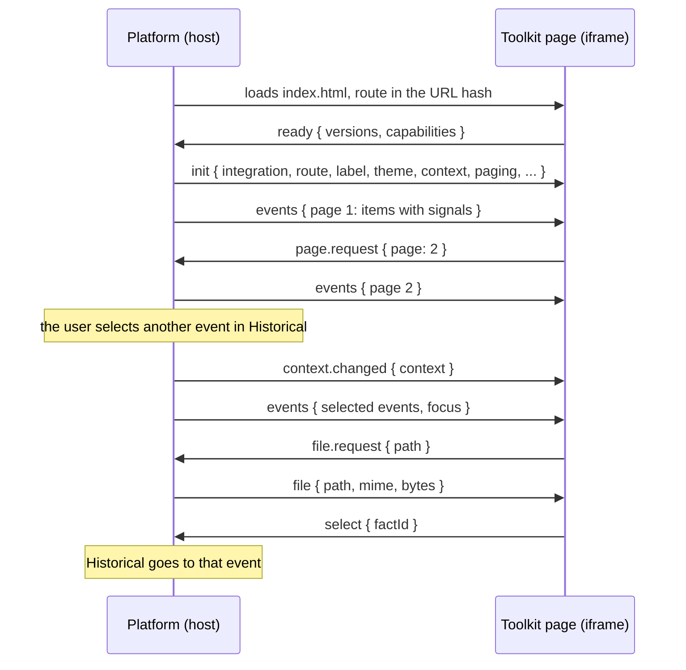
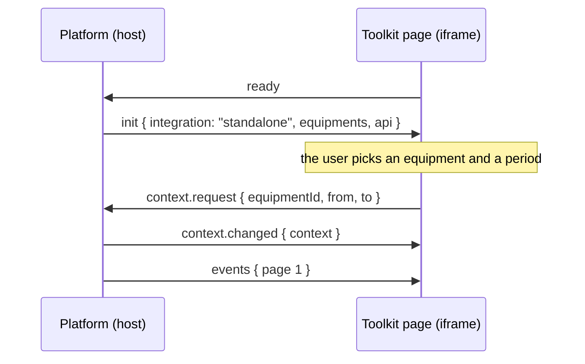

The Platform (the **host**) and the toolkit page in its iframe exchange messages with
[`window.postMessage`](https://developer.mozilla.org/en-US/docs/Web/API/Window/postMessage).
This page describes every message of `mywai.toolkit.v1` as implemented in Platform 3.2.

## Envelope

Every message, in both directions, has the same shape:

```json
{
  "protocol": "mywai.toolkit.v1",
  "type": "events",
  "id": "h13",
  "payload": { }
}
```

| Field | Meaning |
| --- | --- |
| `protocol` | always `mywai.toolkit.v1`; ignore messages with any other value |
| `type` | the message type, listed below |
| `id` | a unique identifier of the message, chosen by its sender (`h1`, `h2`... from the host) |
| `payload` | the content, specific to each type |

## Origins and security

The host:

- posts only to the **exact origin** of the toolkit, never to `"*"`;
- accepts a message only if it comes from its own iframe (`event.source`) **and** from the
  toolkit origin (`event.origin`) **and** carries `protocol: "mywai.toolkit.v1"`;
- gives the user token in `standalone`; elsewhere it sends data, never credentials, unless
  the administrator turns on **Send the user's access token** for that view (off by default);
- sends a file only when the toolkit asks for it, and only if the host listed it before.

<Warning>
Enable token sharing only for trusted toolkits. A toolkit that receives the token can call
the Platform APIs as the user viewing it, with that user's permissions.
</Warning>

The toolkit must:

- send `ready` to `window.parent` with target origin `"*"`: it is the only message sent before
  the host is known, and it carries nothing private;
- take the host origin from the first `init` it receives, coming from `window.parent`;
- from then on, accept only messages from `window.parent` with that origin, and post to that
  origin only.

<Info>
With the files served through the Platform API, the toolkit origin is the origin of the
Platform Web API (e.g. `https://platform-api.example.com`) and the host origin is the one of
the Platform Web application. They differ: always compare `event.origin` explicitly.
</Info>

## Sequence



In `standalone` (Marketplace) the host sends `init` and then waits: the toolkit asks for data.



## Messages from the toolkit to the host

| Type | Payload | Effect |
| --- | --- | --- |
| `ready` | `versions`: protocol versions supported, `capabilities`: features of the page (e.g. `paginated`, `select`, `standalone`, `files`) | the host sends `init`, then the first page of events. The first valid `ready` starts the session; repeated `ready` messages are ignored |
| `page.request` | `page`: integer from 1 | the host sends `events` for that page |
| `context.request` | `equipmentId`, `from`, `to` (UTC milliseconds, or both `null` for every event of the equipment) | `standalone` only: the host sends `context.changed` and `events` |
| `cursor` | `timeMs`: finite UTC milliseconds | in Historical: highlight a nearby recorded position on the location map; invalid or out-of-period times are ignored |
| `select` | `factId` | in Historical: the same as **go to** in the Events panel (the event is selected and the period moves to it) |
| `file.request` | `path`: a file listed in a `files` signal | the host answers with `file` |
| `error` | `message` | the host shows the reason and returns to the native chart in Historical; standalone shows the error |
| `navigate` | `route`: a path declared in the manifest | the host mirrors the toolkit route in the Platform URL, so reloading can reopen it |

### `navigate`

Send `{ route: "/event" }` after your page has moved to a route declared in the manifest
for the current integration. The Platform records the route in its URL:

- Marketplace grid: `?toolkit=<tool id>&route=<route>`;
- the standalone page of one tool: `?route=<route>`;
- Historical: `?toolkitView=<view id>&route=<route>`.

Existing parameters are preserved. The current history entry is replaced, so every
internal toolkit navigation does not create a Platform Back entry. On reload, the Platform
reopens the declared route when its tool or view is still available. Your page still manages
its own hash routing; `navigate` reports that change to the host.

## Messages from the host to the toolkit

| Type | Payload | When |
| --- | --- | --- |
| `init` | integration, route, label, theme, context, paging; equipments in `standalone`; user and api in `standalone` and in views that share the token | after the first valid `ready` |
| `events` | a page of events, or the selected events, with their signals | after `init`, `page.request`, `context.request`, a change of the selection or period; event views marked Live also refresh after relevant WebApi changes |
| `context.changed` | `context` | when the period, selection, equipment or measured location track changes. Clear what you show and wait for the next `events` |
| `file` | `path` with `mime` and `bytes`, or `path` with `error` | after `file.request` |
| `cursor` | `timeMs`, `source: "platform"` | the Historical chart cursor moves within the current period |
| `token.refreshed` | `token`, `expiry` (UTC milliseconds) | when the toolkit received a token (standalone or a view that shares it) and the Platform refreshes it |

The messages `events.added`, `events.updated` and `events.removed` are
part of the standard but are not sent yet. An event view with the **Live** option receives
its first page again as `events` after a relevant Platform change, notified through
SignalR. This includes event labels, fact edits and deletions, imports and completed saved
algorithm outputs linked to the events. Selected-event views match notified event IDs or
the loaded period; a batch without either hint also refreshes the equipment view.

While page 1 is open, the host polls every **60 seconds** as a safety refresh. Events
acquired from the Edge through Azure Functions or IoT Hub send no notification and are
picked up by this poll. If the hub subscription is unavailable, page 1 polls every
**30 seconds**; reconnecting also reloads page 1. A push can return a paginated view to
page 1 even while a later page is open. The separate `live` integration uses
`rows`/`rows.added`, described below.

### `init`

```json
{
  "integration": "selected-events",
  "route": "/event",
  "routes": [
    { "path": "/", "title": "Overview", "integrations": ["standalone", "period-events"] },
    { "path": "/event", "title": "Selected events", "integrations": ["selected-events"] }
  ],
  "label": "Tactical display",
  "theme": "dark",
  "locale": "it-IT",
  "context": {
    "equipment": { "id": 49, "name": "Hydrophone array 3 sensors" },
    "signals": [
      { "sensorMeasureId": 1229, "dataPath": "Hydrophone array 3 sensors/Hydrophone contact tracker/contacts", "measureType": 0 },
      { "sensorMeasureId": 1210, "dataPath": "Hydrophone array 3 sensors/hydrophone_1/hydrophone_1", "measureType": 6 }
    ],
    "from": 1794305070000,
    "to": 1794305190000,
    "eventSpanMs": 900000,
    "selectedFactIds": ["f8efac8f-9f44-4844-bc15-3f48e7fed10d"],
    "focusFactId": "f8efac8f-9f44-4844-bc15-3f48e7fed10d"
  },
  "paging": { "page": 1, "pageSize": 20, "total": 0, "paginated": true }
}
```

| Field | Meaning |
| --- | --- |
| `integration` | the [integration](/3.2/marketplace-tools/toolkits#integrations) the page is hosted in: it says which contract applies |
| `route`, `routes` | the route opened and every route of the manifest |
| `label` | the label of the view configured in the Platform (the tool name in the Marketplace) |
| `theme` | `dark` or `light` |
| `locale` | the browser language of the user |
| `context.equipment` | `{ id, name }`, with optional measured `location` and `track` (below), or `null` in `standalone` before a `context.request` |
| `capabilities.cursor` | `true` when the host handles toolkit replay cursors, as in Historical |
| `context.signals` | the signals selected in the Platform: `sensorMeasureId`, `dataPath`, `measureType` |
| `context.from`, `context.to` | the period, in UTC milliseconds |
| `context.eventSpanMs` | how long after its timestamp an event owns signal rows (set in the view) |
| `context.selectedFactIds`, `context.focusFactId` | `selected-events`: the events chosen in the Platform and the one the user acted on last |
| `paging` | `page`, `pageSize`, `total` (0 until the first `events`), `paginated` |
| `x-limits` | `maxEvents` (500), `maxEventOutputs` (2,000), `maxTrackPoints` (500), `maxInlineOutputBytes` (4,194,304), `maxFileBytes` (67,108,864) |
| `user` | `standalone`, and views with **Send the user's access token**: `id`, `name`, `surname`, `email` of the signed-in user |
| `equipments` | `standalone` only: `[{ id, name }]` the user can choose from |
| `api` | `standalone`, and views with **Send the user's access token**: `{ endpoint, token, expiry }`, the Platform Web API base URL, user access token and its expiry in UTC milliseconds |

In `standalone`, and in a view that shares the token, the page may call the [Platform APIs](/3.2/marketplace-tools/platform-apis-usage-examples)
with `Authorization: Bearer <token>`. Store the initial token and expiry, then replace them
when `token.refreshed` arrives. The host starts refreshing 60 seconds before expiry and
retries if the session has no newer token yet. If a token expires before renewal succeeds,
pause API calls and ask the user to sign in again when necessary; do not reuse an expired token.

### Location and cursor

When a measured location is configured and the Historical host has its track,
`context.equipment` also contains:

- `location`: the last fix in the loaded period, or `null` if there is none;
- `track`: chronological fixes in that period, each `{ lat, lng, timeMs }`; an empty array
  means no fixes were found. Without a configured measured location these fields are omitted.

Long tracks are sampled across the period up to `init["x-limits"].maxTrackPoints` (500),
keeping the first and last fix. Read updated location data from `context.changed` as well
as `init`. This limit applies to the shared track, not to event signal rows.

The cursor works in both directions:

- **Chart to toolkit:** the host sends `cursor` with `{ timeMs, source: "platform" }` at
  most once every 150 ms. Use it to move your replay to that time when it is in your recording.
- **Toolkit to map:** when `init.capabilities.cursor` is true, send `cursor` with
  `{ timeMs }` as the user moves the replay. Historical highlights a nearby recorded fix
  on its location map; a gap without a nearby fix has no highlight. This does not move
  the Platform chart cursor.

Keep received cursor changes separate from your own user input: do not echo them back.
Throttle replay updates too. The host ignores non-finite times and times outside the
loaded period, allowing a one-second tolerance at either boundary. A malformed cursor
message is ignored without closing the view.

### `events`

```json
{
  "page": 1,
  "pageSize": 20,
  "total": 1,
  "selected": true,
  "focus": "f8efac8f-9f44-4844-bc15-3f48e7fed10d",
  "paged": false,
  "items": [
    {
      "factId": "f8efac8f-9f44-4844-bc15-3f48e7fed10d",
      "time": 1794305100000,
      "title": "ships_and_close_intruder",
      "labels": [],
      "signals": [
        {
          "sensorMeasureId": 1229,
          "dataPath": "Hydrophone array 3 sensors/Hydrophone contact tracker/contacts",
          "measureType": 0,
          "fields": [
            "track_id",
            "bearing_deg",
            "bearing_sigma_deg",
            "x_m",
            "y_m",
            "range_m",
            "range_sigma_m",
            "srp_power",
            "level_db"
          ],
          "rows": [
            [
              1794305100500,
              1,
              36.86,
              0.33,
              59.02,
              78.73,
              98.39,
              21.2,
              0.89,
              -57.0
            ],
            [
              1794305100500,
              2,
              117,
              0.34,
              null,
              null,
              null,
              null,
              0.26,
              -62.46
            ]
          ]
        },
        {
          "sensorMeasureId": 1210,
          "dataPath": "Hydrophone array 3 sensors/hydrophone_1/hydrophone_1",
          "measureType": 6,
          "fields": [],
          "rows": [],
          "files": [
            {
              "path": "audio/35_6392..._ships_and_close_intruder_hydrophone_1.wav",
              "name": "35_6392..._ships_and_close_intruder_hydrophone_1.wav",
              "timeMs": 1794305100000
            }
          ]
        }
      ],
      "outputs": []
    }
  ],
  "truncated": false
}
```

| Field | Meaning |
| --- | --- |
| `page`, `pageSize`, `total` | the page sent and the total number of events |
| `paged` | `false` when the items are not a page (selected events, or a non-paginated view): hide the pager |
| `selected` | `true` when the Platform chose these events (`selected-events`): show them, do not offer a list of your own |
| `focus` | the `factId` to open first, or `null` |
| `items[]` | the events: `factId` (string), `time` (UTC milliseconds), `title`, `labels` (label titles, newest first, without duplicates) and `signals` |
| `items[].signals[]` | each event’s signal rows and files, restricted to that event’s time window (below) |
| `truncated` | `true` if a non-paginated selection was larger than the host limit; `total` still gives its full size |

**Signal rows.** For signals of numeric or text data types, `fields` names the columns and
each row is `[timeMs, value of field 1, value of field 2, ...]`:

- rows are sent as stored, without interpolation or sampling, and sorted by time;
- missing values are `null`, so the columns of a row stay aligned;
- several rows can share the same instant (for example one row per tracked object): never
  merge rows by timestamp.

**Signal files.** For data types stored as files (image, audio, video, text, document, 3D,
generic, tensor) `rows` is empty and `files` lists them: `path`, `name`, `timeMs`. The list
never contains bytes or links: ask for a file with `file.request`.

**Which rows.** Each event carries its own `signals`, covering `[time, time + eventSpanMs)`
(the end is excluded). With `period-events` the read also stops at the end of the selected
period. Windows may overlap: a row in their overlap belongs to both events. Their boundaries
do not depend on the next event or the page size. With `selected-events`, distant windows
are read separately.

**Saved outputs.** Each event also carries `outputs`, containing only completed results
with persisted provenance to that event. The result, its stream and all source events must
be visible to the user. Results without recorded provenance are not guessed from timestamps.
An empty list means no accessible, explicitly linked saved outputs were found.

Each output contains `algorithm: { id, name }`, `outputKey`, `itemKey`, `streamVersionId`,
`sensorMeasureId`, `dataPath`, `measureType`, `inline` and an optional
`file: { path, name, timeMs }`. For time series, `inline.fields` declares field names/types
and `inline.rows` contains timestamps and values. A file is also listed in that event’s
`signals[].files[]`: request it with `file.request`. No storage URL or credential is exposed.

The host reads at most 2,000 output associations and 4 MiB of inline-output JSON for one
request. If a limit is exceeded, loading fails explicitly: narrow the selection. The host
does not silently omit outputs.

`measureType` values: 0 Timeseries, 1 SmallInt, 2 Integer, 3 Float, 4 String, 5 Image,
6 Audio, 7 Video, 8 Text, 9 Document, 11 ThreeD, 13 Generic, 15 Events, 16 Tensor.

### Paging

- A paginated view receives page 1 and asks for the next ones with `page.request`.
- A non-paginated view receives up to 500 events in one message, with `paged: false`. If
  events were left out, `truncated` is `true`; show the user that the selection is incomplete.
- The page size is set in the view configuration (1 to 500, default 20).

### `file.request` and `file`

```js
// toolkit → host
{ "protocol": "mywai.toolkit.v1", "type": "file.request", "id": "t7",
  "payload": { "path": "audio/35_6392..._hydrophone_1.wav" } }

// host → toolkit, success: bytes is an ArrayBuffer (transferred, not copied)
{ "protocol": "mywai.toolkit.v1", "type": "file", "id": "h21",
  "payload": { "path": "audio/35_6392..._hydrophone_1.wav", "mime": "audio/wav", "bytes": ArrayBuffer } }

// host → toolkit, failure
{ "protocol": "mywai.toolkit.v1", "type": "file", "id": "h22",
  "payload": { "path": "audio/other.wav", "error": "This file was not shared with the toolkit." } }
```

- The host reads the file with the user's session. Only paths listed in a `files` signal
  sent to the same iframe are accepted.
- Files larger than **64 MiB** are refused with an `error`.
- Ask one file at a time and add a timeout of your own (60 seconds is a good value).

## Other hosted integrations

These integrations use the same envelope, exact-origin checks and lazy `file.request`/
`file` exchange. They receive no token unless the view shares it. A registered route must declare the integration.

| Integration | Host message | Payload |
| --- | --- | --- |
| `live` | `rows`, then `rows.added` | `signals` with raw rows/files and the current `from`/`to` window; refresh reads overlap, so retain identical-timestamp rows and deduplicate retransmitted complete rows. Empty updates still advance `from`/`to`; expire old samples even when acquisition is quiet |
| `file-viewer` | `file.opened` | `file` (`path`, `name`, `measureType`, `timeMs`, `durationMs`, `metadata`), its `signal` and known `event` |
| `processing-result` | `outputs` | `job: { id, algorithm }`, `items` with `outputKey`, `itemKey`, `dataType`, `sourceDataPath`, `detectionTime`, `metadata`; time series carry `fields`/`rows`, file outputs a `file` descriptor |
| `equipment-tab` | `equipment` | equipment, signal descriptors, `events`, `total`, `page`, `pageSize`, and transitional page-level `rows`; events carry their canonical per-event signals/outputs |
| `dashboard-widget` | `latest` | equipment, latest `events`, `signals`, `total`, and refresh time `at` |
| `dataset-version` | `dataset.items` | `version` (id, number and dataset), `page`, `pageSize`, `total`, `items` with id, factId, time, title, label and file descriptors |
| `image-classification`, `image-anomaly-detection`, `image-object-detection` | `images` | page, pageSize, total, `paged`/`truncated`, focused image path `focus`, `coordinates: "image-pixels"`, and the items below |

File paths of unsaved processing outputs are opaque handles: pass them back unchanged in
`file.request`. The host reads that job’s preview using the user’s session.

### Image predictions: `images`

Each `items[]` entry contains:

- `file: { path, name, measureType: 5 }` for the original image;
- `labels`: reference label names; `prediction: { label, score }` when the algorithm returned
  a classification (the score can be `null` and is not manufactured by the viewer);
- `regions`: returned image-pixel coordinates (`x`, `y`, `width`, `height`, optional `points`),
  label and score;
- `pixelMap`, when available: a JSON-file descriptor plus `shape`, `dtype`, `encoding`,
  `kind`, `reference`, `origin` and `classes`. Request its `file.path` lazily, parse the UTF-8
  JSON and decode the map using its declared encoding. `base64_zlib` means base64, then zlib,
  then the typed array in row-major `[height, width, channels]` order.

Only images present in the native viewer’s current collection are shared. Full storage paths
associate predictions with images: equal filenames in different folders are different items.
No image bytes, map bytes, storage URLs or tokens appear in `images`. A missing prediction or
map means none was returned; it is not a negative classification.

The PNS toolkit’s three image routes inspect these predictions over spectrograms. They do
not perform a new acoustic classification or establish vessel/diver identity. Test-fixture
predictions demonstrate transport and rendering; model quality needs separate validation.

## A minimal client

The script below is a complete toolkit side of the protocol, without dependencies. Load it
before your application code.

```js
// toolkit-protocol.js — toolkit side of mywai.toolkit.v1
(function (global) {
  "use strict";
  const PROTOCOL = "mywai.toolkit.v1";
  let hostOrigin = null;
  let counter = 0;
  const handlers = {};
  const pendingFiles = new Map();

  function send(type, payload) {
    if (window.parent === window) return; // not hosted
    const message = { protocol: PROTOCOL, type, id: "t" + ++counter, payload: payload || {} };
    // "ready" carries nothing private: the only message sent before the host is known
    window.parent.postMessage(message, type === "ready" ? "*" : hostOrigin);
  }

  function on(type, handler) {
    handlers[type] = handler;
  }

  function requestFile(path) {
    if (pendingFiles.has(path)) return pendingFiles.get(path).promise;
    let settle;
    const promise = new Promise((resolve, reject) => (settle = { resolve, reject }));
    const timer = setTimeout(() => finishFile({ path, error: "The Platform did not send the file" }), 60000);
    pendingFiles.set(path, { promise, timer, ...settle });
    send("file.request", { path });
    return promise;
  }

  function finishFile(payload) {
    const pending = pendingFiles.get(payload.path);
    if (!pending) return;
    clearTimeout(pending.timer);
    pendingFiles.delete(payload.path);
    if (payload.error) pending.reject(new Error(payload.error));
    else pending.resolve({ bytes: payload.bytes, mime: payload.mime || "application/octet-stream" });
  }

  window.addEventListener("message", event => {
    const data = event.data;
    if (event.source !== window.parent || !data || data.protocol !== PROTOCOL || typeof data.type !== "string") return;
    if (data.type === "init" && hostOrigin === null) hostOrigin = event.origin;
    if (event.origin !== hostOrigin) return;
    if (data.type === "file") return finishFile(data.payload || {});
    const handler = handlers[data.type];
    if (!handler) return;
    try {
      handler(data.payload || {});
    } catch (error) {
      send("error", { message: String((error && error.message) || error) });
    }
  });

  function ready(capabilities) {
    send("ready", { versions: [PROTOCOL], capabilities: capabilities || {} });
  }

  global.ToolkitProtocol = { PROTOCOL, send, on, ready, requestFile };
})(window);
```

Using it:

```js
const P = window.ToolkitProtocol;
let state = { integration: null, items: [], api: null, page: 1 };

P.on("init", payload => {
  state.integration = payload.integration;
  state.api = payload.api || null;
  document.documentElement.dataset.theme = payload.theme;
  document.title = payload.label;
  // filters of your own only where the page chooses the data
  document.getElementById("picker").hidden = payload.integration !== "standalone";
});

P.on("events", payload => {
  state = { ...state, items: payload.items, page: payload.page, truncated: payload.truncated };
  // Read each event’s signals from item.signals, not from payload.signals.
  render(state, payload.focus);
});

P.on("context.changed", () => {
  state = { ...state, items: [] };
  render(state, null);
});

P.on("token.refreshed", payload => {
  if (state.api) state.api = { ...state.api, token: payload.token, expiry: payload.expiry };
});

// next page
document.getElementById("next").onclick = () => P.send("page.request", { page: state.page + 1 });

// standalone: ask for the events of an equipment, all periods
document.getElementById("load").onclick = () =>
  P.send("context.request", { equipmentId: Number(document.getElementById("equipment").value), from: null, to: null });

// play the audio file of an event
async function play(file) {
  const { bytes, mime } = await P.requestFile(file.path);
  new Audio(URL.createObjectURL(new Blob([bytes], { type: mime }))).play();
}

P.ready({ paginated: true, select: true, standalone: true, files: true });
```

## Compatibility

- `ready.versions` must include `mywai.toolkit.v1`; `capabilities`, when present, must be an
  object. Send valid envelopes with a string `id` and an object `payload`. A toolkit that does
  not send `ready` within 20 seconds, sends an invalid message (except an ignored cursor) or reports `error` falls back
  to the native chart in Historical, with an explanation.
- Toolkit clients should ignore host payload fields they do not use. Send only the
  toolkit-to-host message types listed on this page; invalid messages other than cursor updates trigger fallback.
- Use `item.labels` and each `item.signals`. Transitional `item.label` and page-level
  `payload.signals` aliases remain for older clients; they are not the canonical event
  contract. An explicitly empty per-event `signals` array is empty: never fall back to
  another event’s rows. Handle `token.refreshed` and `truncated`.
- The retired integration name `selected-event` is read as `selected-events`.
