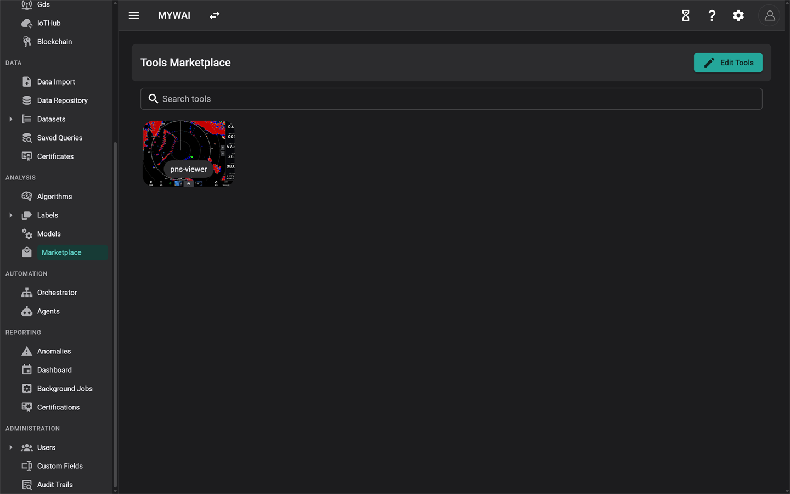
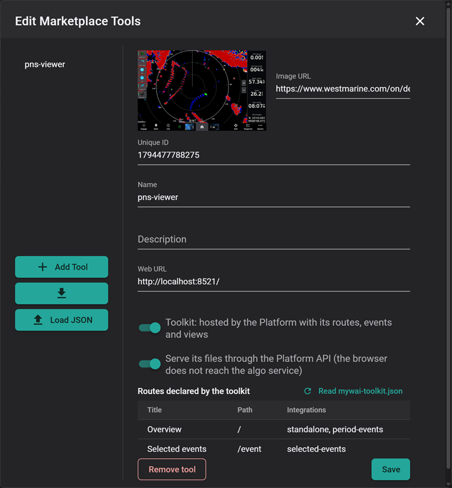
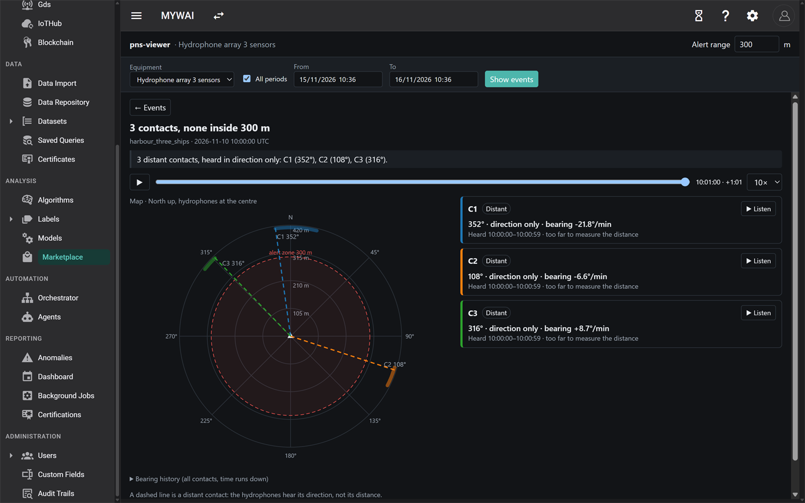
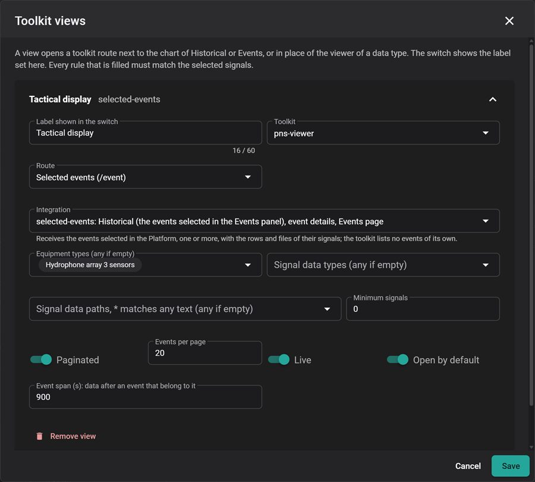
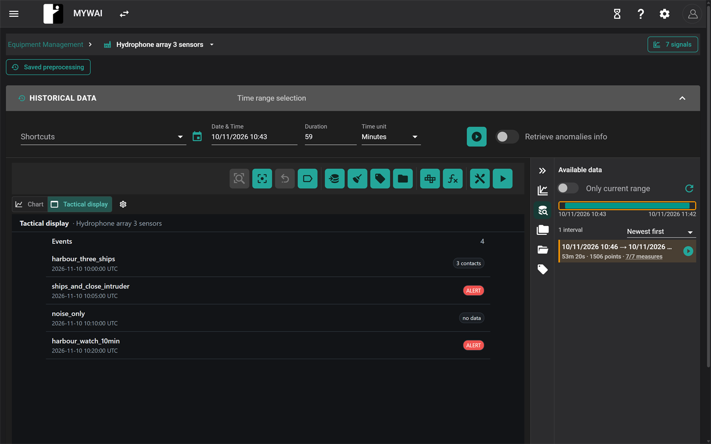
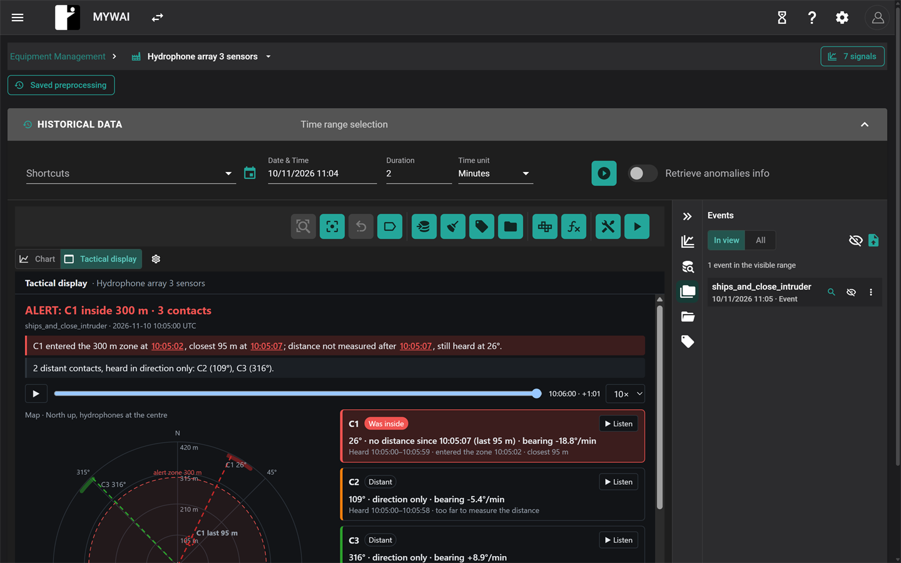

Registering a toolkit and configuring its views requires the **EditMarketplaceTools**
permission (see [Roles Management](/3.2/administration/roles-management)). Users without it
only see and use the result.

## 1. Register the toolkit in the Marketplace



1. Open **Marketplace** and press **Edit Tools**.
2. Press **Add Tool** and select the new tool in the list.
3. Fill **Image URL** (the picture of the card in the Marketplace), **Name** and
   **Description**.
4. In **Web URL** enter the base address of the toolkit, for example
   `http://my-algo-toolkit:80/`.
5. Turn on **Toolkit**. The Platform reads `mywai-toolkit.json` from the Web URL and lists the
   declared routes: title, path and integrations. Press **Read mywai-toolkit.json** again
   whenever the toolkit publishes a new manifest.
6. Leave **Serve its files through the Platform API** on, unless the toolkit must be opened
   directly by the browser (see the [hosting modes](/3.2/marketplace-tools/toolkits/building-a-toolkit#deploying-the-toolkit)).
7. Press **Save**.



<Info>
With **Serve its files through the Platform API**, the Web URL is downloaded by the Platform
Web API server, not by the browser: use an address reachable from that server, such as the
name of the toolkit container on the same network. Without it, the Web URL must be reachable
by every user's browser, in HTTPS when the Platform is in HTTPS.
</Info>

If the manifest cannot be read, the editor shows why, for example:

| Message | What to check |
| --- | --- |
| `The toolkit publishes no mywai-toolkit.json at ... (HTTP 404)` | the manifest is not at the root of the Web URL |
| `The toolkit is not reachable at ...` / `did not answer` | the address, the port and the network between the Web API and the toolkit |
| `... declares protocol '...', the Platform speaks 'mywai.toolkit.v1'` | the `protocol` field of the manifest |
| `Route '...': unknown integration '...'` | the integration names; see the [census](/3.2/marketplace-tools/toolkits#integrations) |

Once saved, the toolkit card opens it in **standalone** mode, on the first route that
declares `standalone`.



In standalone mode the user picks the equipment among those the toolkit is configured for:
when the toolkit has views restricted to some equipment types, only equipment of those types
is offered. The signals sent are the ones matching the rules of the first view of the
toolkit (all the signals of the equipment when it has no view).

## 2. Configure the views in Historical

A **view** decides where a route of the toolkit appears and for which data. Views are
configured in the Platform, per installation: the toolkit itself does not decide where it is
shown.

1. Open the **Equipment Analysis** page of an equipment, select its signals and load a
   period in **Historical Data**.
2. Press the gear next to the **Chart** switch (**Toolkit views**). The gear is visible to
   users with the EditMarketplaceTools permission, as soon as signals are selected.
3. Press **Add view** and fill the fields below, then **Save**.



| Field | Meaning |
| --- | --- |
| **Label shown in the switch** | the text of the button next to **Chart** (1 to 60 characters). The toolkit receives it as its title |
| **Toolkit**, **Route** | the registered toolkit and the page to open |
| **Integration** | what the view shows: `period-events` (the events of the period, listed by the toolkit) or `selected-events` (the events chosen in the Events panel). Only the integrations declared by the route are offered |
| **Equipment types** | the view appears only for these equipment types (any if empty) |
| **Signal data types** | at least one selected signal must be of one of these data types (any if empty) |
| **Signal data paths** | at least one selected signal must match one of these paths; `*` matches any text, e.g. `*/contact tracker/*` (any if empty) |
| **Minimum signals** | the view appears only with at least this number of selected signals |
| **Paginated**, **Events per page** | send the events page by page (1 to 500 per page). When off, up to 500 events are sent at once |
| **Live** | refresh the first page every 30 seconds while the view is open |
| **Open by default** | open this view instead of the chart when it matches |
| **Event span (s)** | how long after its timestamp an event owns signal rows (default 300 s) |

Every rule that is filled must match. Views are saved for the whole installation and apply
to every equipment that matches their rules.

## 3. How users see the view

When the selected signals match a view, Historical shows the switch **Chart | label**. With
**Open by default** the view opens directly; otherwise the user presses its button. Several
matching views give several buttons.



With `selected-events`:

- if no event is selected, the toolkit receives an empty event list: select an event in the
  Platform to show it;
- when the user presses **go to** (magnifier) or **highlight** (eye) on an event of the
  **Events** panel, or highlights every event in view, the toolkit receives the selected
  events and opens the last one the user acted on;
- when the toolkit selects an event (for example a click on its own list), Historical does
  the same as **go to**.



If the toolkit does not send `ready` within 20 seconds, sends an invalid protocol message,
cannot load its data or reports an error, Historical returns to **Chart** and shows the
reason. Its view button stays available, so the user can try again.

## Other places that host views

All twelve integrations are hosted in the 3.2 source. A view is available only where its
integration is hosted, the registered route declares it and the view rules match:

- **Realtime:** `live`, beside the native signal charts.
- **File viewers and Historical audio:** `file-viewer`; use **Viewer measure types** to choose
  which native data-type viewers it replaces.
- **Processing results:** `processing-result`, beside the native run preview. Data-path rules
  match the output keys, not the source equipment’s signal paths.
- **Image Classification, Anomaly Detection and Object Detection:** the corresponding
  `image-*` view, beside **Image viewer**. Filters, model execution and image selection remain
  in the native workspace. While a toolkit view is active, the native image canvas and its
  execution overlays are hidden. Choose **Image viewer** to restore them without losing the
  current image or results. An empty prediction remains empty in the toolkit.
- **Equipment:** `equipment-tab`, shown as a configured equipment tab.
- **Dashboards:** add a **Toolkit view** widget and choose its view and equipment. It refreshes
  the configured signals and latest events every 30 seconds.
- **Dataset versions:** `dataset-version`, beside the native item table. Data-path rules match
  the dataset name.

Use the **Toolkit views** gear to edit the installation’s shared views. New views can remain
optional (**Open by default** off) while validating them. Pages that have a native alternative
return to it on toolkit failure; a standalone toolkit-only tab/widget shows its error.

The example image views are **Spectrogram classes**, **Anomaly inspection** and
**Detected objects**. They display the selected model's predictions. Classification can use
PNS spectrograms; anomaly detection and object detection can use their own image datasets.
An anomaly map is a result even when the model does not return a classification label.

Embedded views use the space of their panel: image workspaces, processing previews,
equipment panels, Marketplace and Dashboard widgets. Resizing a widget resizes its view.
Long view names wrap; large content remains scrollable inside the view. Images fit their
preview area while anomaly maps and detection boxes keep the same image coordinates.
On narrow panels the image list becomes a horizontal strip, preserving the preview space.
The native image canvas is restored when the user chooses **Image viewer**.

## Try the configured views

Follow [Using toolkit views](/3.2/marketplace-tools/toolkits/using-toolkit-views) for twelve
complete paths through the local demonstration installation: selected and period events,
audio files, dataset versions, image classifications, anomaly maps, detected objects,
preprocessing results, the Array equipment view, realtime acquisition, Dashboard widgets
and the full Marketplace viewer.

The guide names the existing datasets and models for each image task. It also explains
which raw hydrophones to select for the contact tracker, when to use **Add step**, how to
review unsaved results and why **All periods** still requires the correct equipment.

## Where the configuration is stored

| File (Platform blob storage) | Content |
| --- | --- |
| `config/tools.json` | the Marketplace tools; a toolkit has a `toolkit` object with `protocol`, `proxied` and the `routes` read from the manifest |
| `config/toolkit-views.json` | the views: label, toolkit, route, integration, rules, paging, live, default, event span |

`tools.json` can also be downloaded and uploaded from **Edit Tools**; the views are changed
from the **Toolkit views** dialog. Example of a registered toolkit:

```json
{
  "uniqueId": "tactical-display",
  "name": "Tactical display",
  "description": "Contacts of the hydrophone array",
  "webUrl": "http://my-algo-toolkit:80/",
  "imageUrl": "https://example.com/tactical-display.png",
  "toolkit": {
    "protocol": "mywai.toolkit.v1",
    "proxied": true,
    "routes": [
      { "path": "/", "title": "Overview", "integrations": ["standalone", "period-events"] },
      { "path": "/event", "title": "Selected events", "integrations": ["selected-events"] }
    ]
  }
}
```
