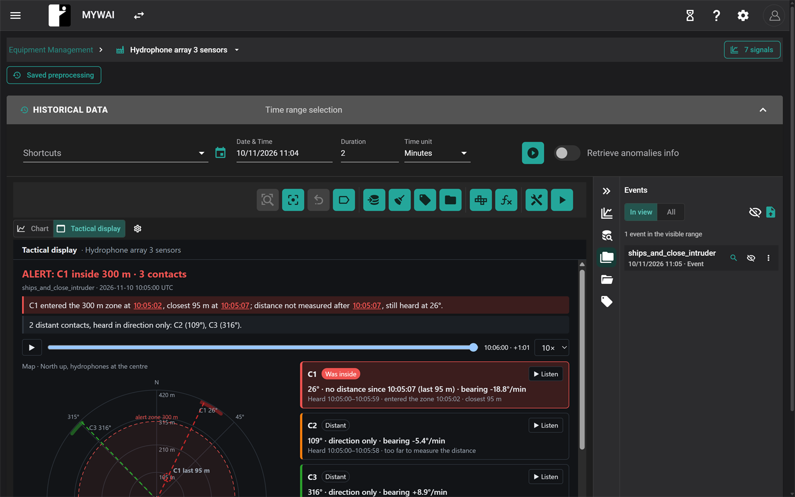
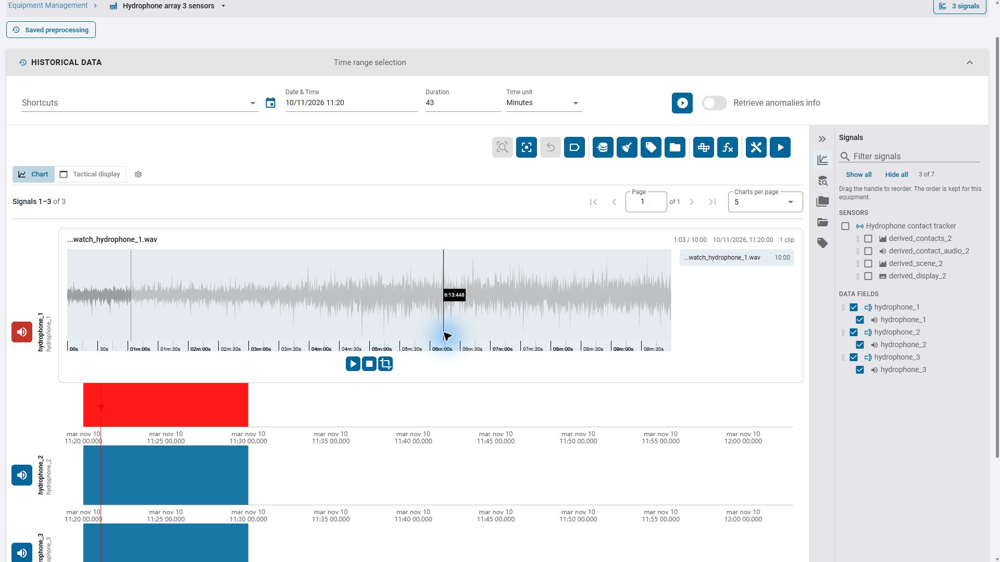
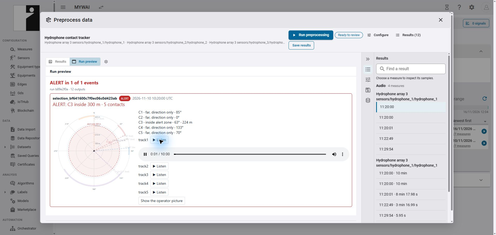
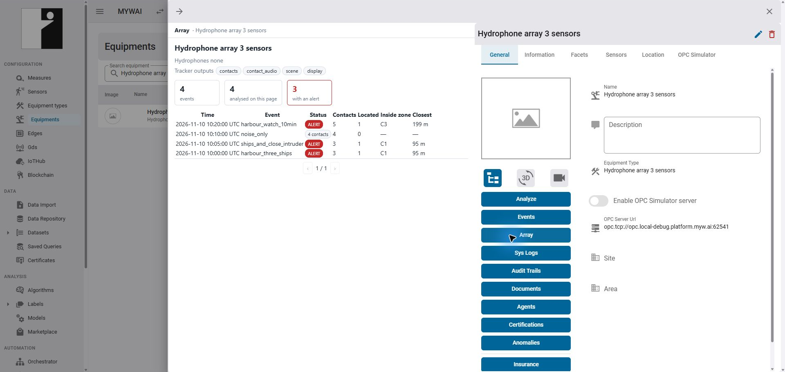
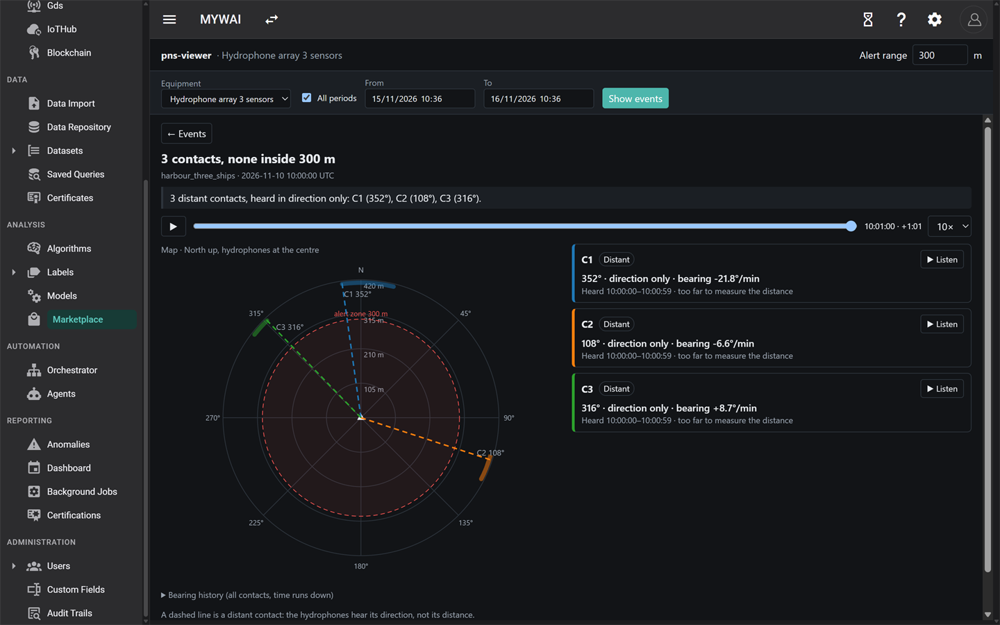
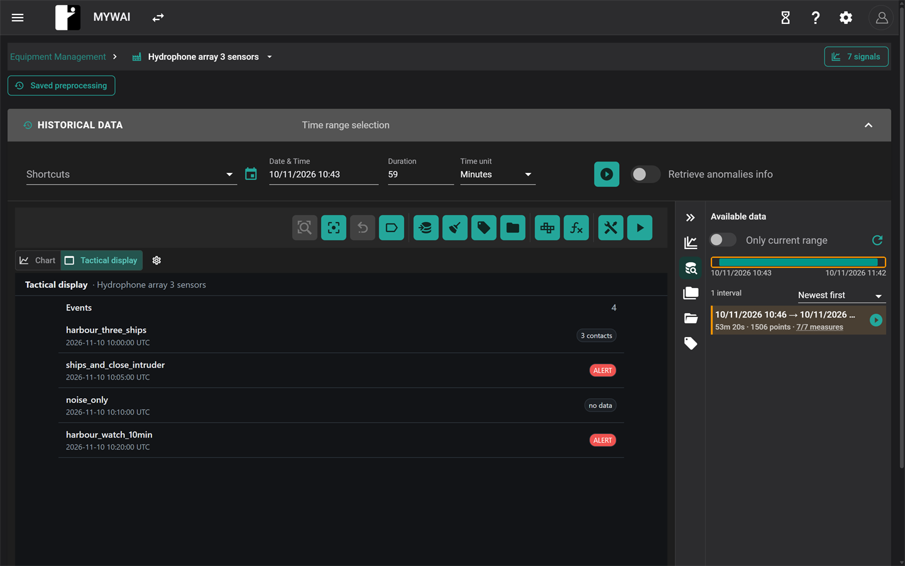

A toolkit view appears beside the Platform's usual chart, player or result viewer. Choose
the view's named button to open it; choose **Chart**, **Player**, **Image viewer** or
**Results** to return to the native view. The gear configures the shared views and is
available only with the corresponding administration permission, after the views have loaded.

For ThreeD files and Historical selections containing ThreeD signals, the native viewer
opens first even when a toolkit has **Open by default**, unless you have a remembered
choice. Choose a toolkit, then **Both**, to compare them: file viewers are side by side
(stacked on narrow screens), while Historical
keeps the chart below the toolkit. Your browser remembers your choice for each user and
3D place. A failure restores the native view for that page without changing this preference.

<Info>
The examples below use datasets, models and equipment already present in the local
demonstration installation. Their names are examples, not equipment or models created
automatically by installing a toolkit. Screenshots show the local Platform. The Platform
date fields use local time; timestamps labelled **UTC** inside the example viewer use UTC.
On 10 November 2026, 11:20 in Europe/Rome is 10:20 UTC.
</Info>

## 1. Open a selected event in Historical

1. Open **Equipments → Hydrophone array 3 sensors → Analyze → Historical data**.
2. In **Signals**, include the tracker's **contacts** signal.
3. Set **Date & Time** to **10/11/2026 11:00**, **Duration** to **35** and **Time unit** to **Minutes**, then press **Retrieve data** (Europe/Rome).
4. Open the workspace's **Events** panel and locate **harbour_watch_10min**.
5. Use its **go to** or **highlight** action, then choose **Tactical display** beside **Chart**.

The view receives the selected event. Its replay controls move through the recording;
the map and contact cards follow the chosen moment. When the equipment has a measured
location, the tactical map shows the array coordinates and fix time. Playing or dragging
the replay also highlights a nearby fix on the Historical location map. When the chart
and toolkit are both visible, moving the chart cursor within the open replay seeks to
that instant. An empty event selection remains empty.

### Follow the location and cursor

1. In the same equipment, keep **contacts** selected and add a signal of type **ThreeD**
   to make **Both** available. Load **10/11/2026 11:00** for **30 Minutes** (Europe/Rome,
   **10:00-10:30 UTC**). A [measured location](/3.2/configuration/equipments#measured-location)
   must be configured and have positions in this period.
2. Highlight **harbour_watch_10min** in the Events panel, choose **Tactical display**,
   then choose **Both**.
3. Move the chart cursor to a time inside the event's replay. A toolkit that supports the
   cursor follows that time. Play or drag the toolkit replay to highlight the nearby fix
   on the Historical location map; try **11:21-11:23** in the local example.

The map shows recorded positions for the loaded period and marks its last fix. Use
**Expand map** for more space. A gap without a nearby recorded position has no highlight.
If the map is absent, check the equipment's Latitude and Longitude configuration; if it
says **No positions in the selected time range**, choose a period with location data.

## 2. Inspect an audio file

1. In the same equipment's **Historical data**, select the original **hydrophone_1** signal.
2. Set **Date & Time** to **10/11/2026 11:20**, **Duration** to **10** and **Time unit** to **Minutes**, then press **Retrieve data** (Europe/Rome).
3. Open its audio player and choose the **watch_hydrophone_1.wav** recording.
4. Choose **Acoustic analysis** beside **Player** to inspect the toolkit's file view.

The toolkit receives that file. The example view shows a spectrogram and modulation
analysis; **Player** restores the native waveform and playback controls. These acoustic
indicators support inspection and do not certify a source's identity.

## 3. Browse a dataset version

1. Open **Datasets → pns examples → Harbour contacts → version 1**.
2. Choose **Classifier training set** beside the native item table.
3. Select a sample to inspect its label and associated recording. Use the page controls
   to browse the remaining items.

This view inspects existing dataset samples. It does not start model training.

## 4. Inspect image classifications

1. Open **Datasets → pns examples → Spettrogrammi-Idrofono → version 0 (base) → Classification**.
2. Select images and press **Run**.
3. Choose **Inception v3**, model `inception_v3_image_classifier_gcmqgnp0rwq13bd6bcpodvf`.
4. When inference completes, choose **Spectrogram classes** beside **Image viewer**.

The toolkit displays the model's returned classifications. Select another image in its
list to inspect its own result. **Image viewer** restores the native workspace.

## 5. Inspect anomaly maps

1. Open **Datasets → Manutenzione → ROV carena - anomalie → version 0 (base) → Anomaly Detection**.
2. For a short trial, select one or two images and press **Run**.
3. Choose **PatchCore**, model `patchcore_7rs8jns0uw4dy4rjbujw5h`.
4. Choose **Anomaly inspection** after inference completes.

The source image and returned anomaly map use the same coordinates. A map remains a
valid result when the model provides no class label. Use this dataset for the anomaly
example; the PNS spectrogram classification dataset serves a different example.

## 6. Inspect detected objects

1. Open **Datasets → Manutenzione → Ponte di volo - object detection → version 0 (base) → Object Detection**.
2. Select one or two images and press **Run**.
3. Choose **YOLOv8 Object Detection**, model `yolo_detection_vfo41hpcy0hzohkmyk88j`.
4. Choose **Detected objects** after inference completes.

The view overlays the regions returned for the selected image. Boxes stay aligned when
the preview changes size. An image with no detected regions remains empty.

## 7. Review a preprocessing run

1. Open **Equipments → Hydrophone array 3 sensors → Analyze → Historical data**.
2. In **Signals**, select only **hydrophone_1**, **hydrophone_2** and **hydrophone_3**.
   Clear the derived tracker signals **contacts**, **contact_audio**, **scene** and **display**.
3. Set **Date & Time** to **10/11/2026 11:20**, **Duration** to **10** and **Time unit** to **Minutes**, press **Retrieve data**, then **Preprocess** (Europe/Rome).
4. Keep **Selected time period** and add **Hydrophone contact tracker** as the first step.
   If it is already shown as the first block, it is already selected. **Add step** adds
   another step after it.
5. Check the three source paths and the time range in the header, then press **Run preprocessing**.
6. Wait for **Ready to review** and choose **Run preview** beside **Results**.

Run preview shows the actual outputs of this execution. **Save results** is a separate
action: reviewing a result does not save it into the equipment's historical signals.
In the captured local run the Platform produced 12 outputs for one selected event.
Different recordings or parameters may produce a different number.

If a run fails, open **Results** and expand **Processing details** to read the failure.
A failed operation remains in the history; starting a new run creates another operation.
When reporting a failure, include its message and job ID. A storage **Permission denied**
requires an installation administrator to restore the output staging directory's write
access; changing detection parameters does not grant that access.

## 8. Open the equipment's Array view

1. Open **Equipments** and open **Hydrophone array 3 sensors**.
2. Leave edit mode if it is active.
3. Press **Array**, below **Events** in the equipment details.

The configured equipment view shows its signals and recorded events. It opens in the
equipment side panel when that panel hosts the detail; otherwise it opens in a dialog.
Close the view with the cross in its header to return to the equipment.

Only the signals included by the view rules are listed. An omitted hydrophone is not evidence that the equipment has no recording.

## 9. Observe a running acquisition

1. Open **Equipments → SIM - Time series → Analyze → Real time data**.
2. Select the signals ending in **/vib** and **/pressione_mandata**.
3. Press **Play**, then choose **Live signals**.
4. In another tab, open **Edges** and use the pencil to edit **Edge-Kla-LocalEnv-1**.
5. In its **Flows** list, locate **SIM - Time series** and press **Start flow on edge**.

This existing demonstration flow acquires for about 15 seconds. The values remain in
the configured five-minute live window and disappear as they age out. For another capture,
stop the flow first if its status still says running, then start it again.

## 10. Show a toolkit in a dashboard

1. Open the intended **Dashboard** and add or edit a **Toolkit view** widget.
2. Choose **Harbour status** and equipment **Hydrophone array 3 sensors**.
3. Save the widget and leave dashboard edit mode.

The view follows the widget's available space and refreshes the latest recorded events.
Historical hydrophone events do not establish that the equipment is acquiring live data.

## 11. Open the full Marketplace viewer

1. Open **Marketplace → pns-viewer**.
2. In **Equipment**, explicitly choose **Hydrophone array 3 sensors**.
3. Leave **All periods** checked and press **Show events**.
4. Open **harbour_watch_10min** from the list.

**All periods** applies to the chosen equipment; it does not search every equipment.
The full viewer provides its own equipment selector, event list and replay controls.

## 12. Show all events in a period

1. Open **Equipments → Hydrophone array 3 sensors → Analyze → Historical data**.
2. In **Signals**, include the tracker's **contacts** signal.
3. Set **Date & Time** to **10/11/2026 11:00**, **Duration** to **35** and **Time unit** to **Minutes**, then press **Retrieve data** (Europe/Rome).
4. Choose **Events in period** beside **Chart**.

The configured view lists the acquired events in that interval without requiring a
highlighted event. This differs from **Tactical display**, which follows the events
selected in the Platform's Events panel.

If the administrator enables **Live** for the view, changes saved in the Platform
(event labels, edits, imports and saved algorithm outputs) refresh the first page promptly.
Keep page 1 open to see Edge-acquired events within the 60-second safety refresh; while
disconnected from event notifications, it polls every 30 seconds. **Live** here updates
events; **Live signals** in the realtime path above shows a rolling window of signal rows.

## If a view is missing

- Check the selected equipment, signals and dataset version before opening the view.
- For **Array**, use the equipment detail outside edit mode.
- For image views, open the matching Classification, Anomaly Detection or Object Detection workspace.
- For **Run preview**, wait for an execution with available outputs.
- An administrator can check the integration, route and matching rules in **Toolkit views**.

See [Registering a toolkit and configuring views](/3.2/marketplace-tools/toolkits/registration-and-views)
for the shared configuration, and [Building a toolkit](/3.2/marketplace-tools/toolkits/building-a-toolkit)
for development and hosting.
